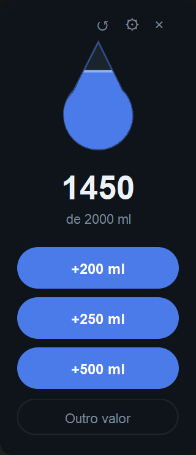

# Water Tracker

[](https://github.com/augustodbatista/water-tracker/actions/workflows/ci.yml)


[](LICENSE)

**A desktop widget that logs water intake in one click.**

It sits on your screen all day, always on top, and the drop fills up as you get
closer to your daily goal. No account, no network: data lives in a local JSON file.

<p align="center">
  
</p>

> The interface is in Portuguese. Class names are in English; comments, test
> names and the engineering notes in [CLAUDE.md](CLAUDE.md) are in Portuguese.

## Features

- **One click per glass:** +200, +250 or +500 ml, or any other amount.
- **The drop is the progress bar:** it fills toward a configurable daily goal.
- **Undo a mistaken entry** or clear the day, kept away from the main buttons so a
  misclick cannot turn into a worse misclick.
- **Rolls over at midnight** on its own, even when the widget stays open for days.
- **Runs on Windows and Linux** (developed on Windows and Pop!_OS), and CI proves it
  on both at every push.

## Engineering highlights

- **Quality gates in one command.** `mvn clean verify` runs Checkstyle
  (`google_checks`), compiles, runs the tests, enforces **≥ 85% line coverage** on
  non-UI code with JaCoCo, and runs static security analysis with SpotBugs +
  FindSecBugs. If it passes, the commit is shippable.
- **Test-first from the first commit**, with CI on a Windows + Linux matrix and
  `fail-fast: false`, so an OS-specific failure (path separators, line endings,
  encoding) shows up on both runners instead of being cancelled.
- **Data on disk is treated as untrusted input.** The JSON file goes through a
  private DTO and is re-validated by the domain, so a hand-edited or corrupted file
  becomes a named `CorruptedDataException` instead of a crash or silently wrong
  totals.
- **Crash-safe writes:** a temp file plus an atomic move, so a crash mid-write never
  truncates the data.
- **Immutable domain:** records, validation in constructors (an invalid entry can
  never exist), named domain exceptions, daily sums accumulated in `long` to avoid
  overflow.
- **No speculative abstractions:** the repository is a concrete class tested
  against a real temp directory; an interface arrives only with a second real
  implementation.
- **One production dependency** (Gson), confined to the storage package. Dependency
  updates arrive through Dependabot.

### Lessons recorded along the way

Every non-obvious problem is logged in [CLAUDE.md](CLAUDE.md) with its fix. Two
that are worth knowing:

- **A green build with zero tests.** Maven's default Surefire (2.12.4) does not
  see JUnit 5, so the build passed while running nothing. The fix pins Surefire 3.x,
  and the habit is to always check `Tests run: N`, never just `BUILD SUCCESS`.
- **Midnight never arrived.** The daily total was computed with the current date,
  but only refreshed on user action, so a widget left open overnight kept showing
  yesterday. A Swing timer now checks for the day change and refreshes the total.

## Running it

Requires JDK 21+ and Maven 3.9+.

```bash
mvn clean verify
java -jar target/water-tracker-1.0.0-SNAPSHOT.jar
```

Data is stored in `~/.water-tracker/` (`entries.json` and `daily-goal.txt`).

### Desktop shortcut

**Windows** (PowerShell) — creates a shortcut on the Desktop; adjust the path to
where you built the jar:

```powershell
$jar = "C:\path\to\water-tracker\target\water-tracker-1.0.0-SNAPSHOT.jar"
$s = (New-Object -ComObject WScript.Shell).CreateShortcut("$([Environment]::GetFolderPath('Desktop'))\Water Tracker.lnk")
$s.TargetPath = "$env:JAVA_HOME\bin\javaw.exe"
$s.Arguments = "-jar `"$jar`""
$s.Save()
```

**Linux** — create `~/.local/share/applications/water-tracker.desktop`:

```ini
[Desktop Entry]
Type=Application
Name=Water Tracker
Exec=java -jar /path/to/water-tracker-1.0.0-SNAPSHOT.jar
Terminal=false
Categories=Utility;
```

The window and taskbar icon are drawn by the app itself, so no icon file is needed
on either system.

## Project structure

```
src/main/java/io/github/augustodbatista/watertracker/
├── domain/    WaterEntry, DailyIntake, InvalidVolumeException
├── storage/   JsonIntakeRepository, DailyGoalStore, CorruptedDataException
├── ui/        the Swing window (excluded from the coverage gate)
└── App.java   entry point
```

Dependencies point inward: `ui` and `storage` depend on `domain`, never the reverse.

## How it was built

Built with an AI pair programmer ([Claude Code](https://claude.com/claude-code))
under Extreme Programming rules written in [CLAUDE.md](CLAUDE.md): I set direction,
make the product decisions and review; the AI implements and is expected to question
decisions and raise risks. Test-first, green CI on every commit, small releases.

## License

[MIT](LICENSE)
